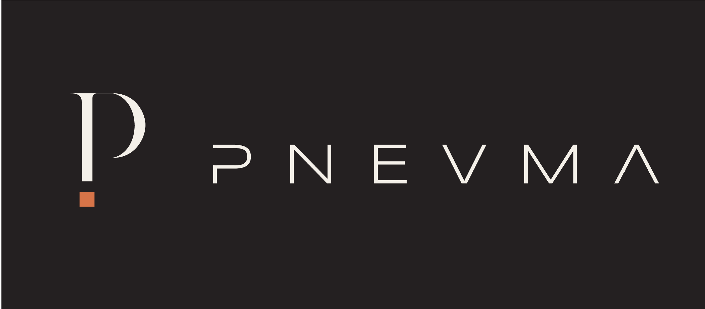

<h1 align="center">Pnevma Art Library</h1>

<strong>Your artwork, organized for production.</strong> A Windows workspace for browsing LightBurn libraries and managing design details.

---

## A clear home for your designs

Browse native `.lbart` libraries in a visual gallery, find designs across loaded
collections, and keep useful product details alongside the vectors. Pnevma Art
Library brings organization, search and artwork transfer into one desktop workspace.

| Organize | Find | Prepare |
| --- | --- | --- |
| Libraries and folders | Indexed cross-library search | SKU and product details |
| Colors and icons | Greek/Latin keyboard-layout matching | Cost, wholesale and retail |
| Multi-selection and copying | Favorites and status filters | Product photos and import/export |

The application includes workflows for exchanging artwork with LightBurn, Excel
metadata import and portable library bundles. LightBurn is a separate application
and license. Compatibility qualification is ongoing.

## Current status

**Windows x64 · In development · Proprietary software**

This repository is the product homepage. **App downloads are not published yet.**
The current internal version is 0.6.3. Historical builds, development files and
application source are maintained privately. No artwork library or customer data
is distributed through this repository.

## What is next

- A qualified Windows release with a supported runtime and signed distribution.
- Improved recovery, onboarding, customer settings and accessibility.
- Subscription accounts, billing and clear offline access rules.
- Native Mac and iPad applications, following platform feasibility work.

These are planned directions, not currently available subscription or Apple products.
There is no public release date commitment.

## Ownership

Copyright © 2026 Pnevma. **All rights reserved.** Pnevma Art Library is proprietary
and is **not open source**. The application source is not included in this public
repository. See [LICENSE](LICENSE).

Pnevma Art Library is independent of LightBurn Software. No official certification,
endorsement or partnership is claimed.
